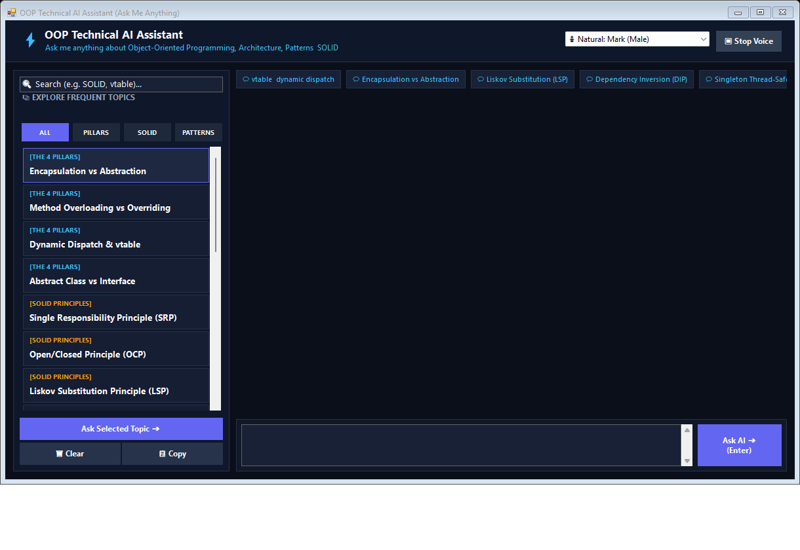

# 🎯 Adaptive Interview Challenge — AI Mock Interview Simulation Bot
> **A high-fidelity, adaptive technical interview simulation platform featuring real-time difficulty progression, in-flight interviewer curveballs, candidate Elo skill tracking, and FAANG Staff-level architecture debriefs.**



---

## 🌟 Key Highlights

### 1. ⚡ Dynamic Difficulty Escalation (Adaptive Engine)
- **Real-Time Level Scaling:** The simulation dynamically scales difficulty question-by-question based on your performance:
  - **Level 1 (Junior):** Core pillars, object allocation, stack vs heap, basic method contracts.
  - **Level 2 (Mid-Level):** SOLID principles, classical GoF patterns, vtable dynamic dispatch, composition over inheritance.
  - **Level 3 (Senior / Lead):** Liskov contract proofs, thread safety, memory leak prevention, value objects vs entities in DDD.
  - **Level 4 (Staff / Principal):** High-throughput LRU caches, lock-free concurrency, distributed notification architecture, and scale trade-offs.
- **Candidate Skill Rating (Elo):** Dynamic skill meter calibrated between 1000 and 2000+ with performance streaks.

### 2. ⚡ In-Flight Interviewer Curveballs & Production Constraints
- Top-tier tech interviews rarely stick to static questions. Alex Rivera injects unexpected production constraints in real time:
  - *"Interviewer Twist: What happens if 50,000 requests/sec hit this concurrently? Make it lock-free."*
  - *"Interviewer Twist: If a user specifies fallback channels, how do you model this using Chain of Responsibility without hardcoding?"*
  - *"Interviewer Twist: How does your memory layout prevent L1 instruction cache thrashing?"*
- You can also click **"🎲 Throw Live Curveball"** to request dynamic on-the-fly constraints tailored to your exact answer.

### 3. 🤖 Manual On-Demand AI Assistant ("Consult Simulation Interviewer")
- **Zero Automatic Lag:** Answers are evaluated **instantly** using an offline semantic NLP rubric engine with comprehensive synonym mapping.
- **Manual AI Debrief:** When you want deep feedback, click **"🤖 Consult Simulation Interviewer (Alex)"**:
  - Delivers an official FAANG-calibrated hiring decision (*Strong Hire*, *Hire*, *Lean Hire*, *No Hire*).
  - Directly references your exact words and architectural trade-offs.
  - Highlights subtle Staff-level edge cases and blindspots.
  - Poses probing follow-up questions to test your engineering depth.

### 4. 📊 Calibrated Hiring Committee Scorecard
- Final Seniority Level calibration (e.g. *Staff Software Engineer (L6 / E6)*).
- Question-by-question **Trajectory Timeline** showing how difficulty escalated or adapted.
- Domain Competency Radar across Pillars, SOLID, Patterns, and System Design.
- One-click copyable Markdown report for debriefs.

---

## 🚀 Quick Start

### Option A: Web Application (Recommended)
1. Clone this repository:
   ```bash
   git clone https://github.com/PARASAREKAR/adaptive-interview-challenge.git
   cd adaptive-interview-challenge
   ```
2. Install dependencies:
   ```bash
   pip install -r requirements.txt
   ```
3. Run the application:
   ```bash
   python app.py
   ```
4. Open your browser at **`http://localhost:5000`** (or the port displayed in terminal).

### Option B: Native Desktop GUI Application (Tkinter)
Run the native desktop GUI window with interactive chat, real-time ladder progression, and scorecards:
```bash
python desktop_app.py
```

### Option C: Standalone Windows Executable
Double-click `OOP_Interview_Chatbot.exe` for an instant zero-dependency native Windows app with speech synthesis.

---

## 🛠️ Architecture & Tech Stack

| Layer | Technologies |
|---|---|
| **Frontend** | Vanilla JS (ES6+), CSS3 Glassmorphism, Plus Jakarta Sans, Fira Code, Font Awesome 6 |
| **Backend** | Python 3, Flask, REST API |
| **Desktop GUI** | Python Tkinter (`desktop_app.py`), C# Windows Forms (`OOP_Interview_Chatbot.cs`) |
| **AI Engine** | Google Gemini 2.0 Flash (`google-genai`), Offline Semantic Rubric Engine |
| **Speech** | Web Speech API (Speech Recognition & Speech Synthesis) |

---

## 📋 Configuration & API Keys

- **100% Offline by Default:** The simulation functions completely without an internet connection or API keys using its built-in expert rubric engine.
- **Activating Gemini AI Debriefs:** Click **Config** in the top navigation bar and enter your `GEMINI_API_KEY` (or set `export GEMINI_API_KEY="your-key"` in your environment). This unlocks deep conversational debriefs and real-time AI-generated curveballs.

---

## 👤 Author
- **Paras Arekar** — [GitHub (@PARASAREKAR)](https://github.com/PARASAREKAR)
